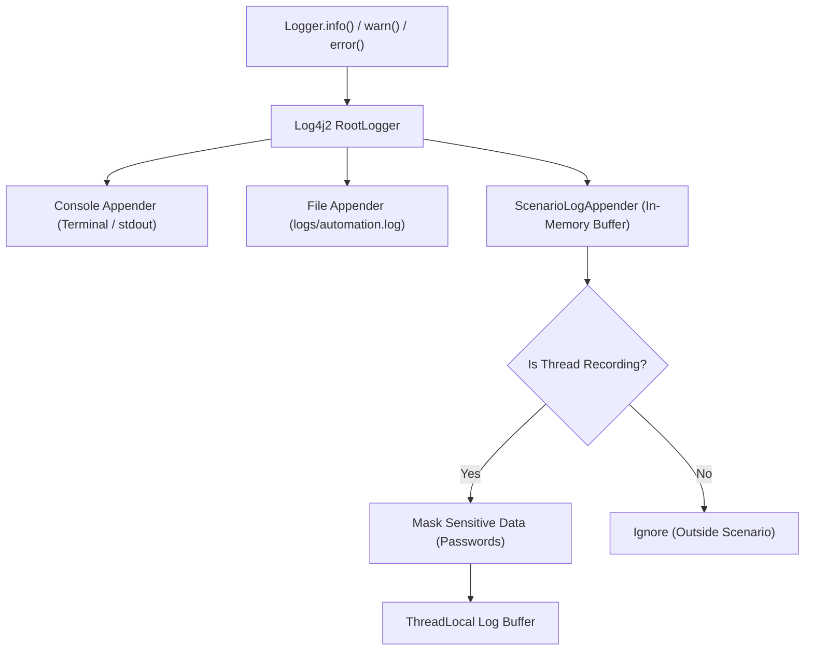

# Enterprise Allure Reporting Knowledge Transfer (KT)

> **Audience**: SDETs, Automation Engineers, QA Leads  
> **Framework**: Selenium WebDriver + TestNG + Cucumber 7 + Allure Reports + Log4j2

---

## Stage 5 Focus: Log4j2 Logging & Diagnostic Integration

### 1. How Log4j2 Operates in this Framework
The framework uses Apache Log4j2 as its enterprise logging backbone:
- **`log4j2.xml`**: Located in `src/test/resources/log4j2.xml`, it defines the root logging configuration.
- **Console Appender**: Streams real-time human-readable execution events directly to `SYSTEM_OUT` during both local IDE runs and CI/CD terminal runs.
- **File Appender (`FileLogger`)**: Appends cumulative execution history across all suites to `logs/automation.log`.
- **`ScenarioLogAppender`**: A custom, in-memory, thread-safe appender attached dynamically to Log4j2's Root Logger to capture logs specifically scoped to an executing Cucumber scenario.



---

### 2. How Scenario-Specific Logs Are Collected
In standard test automation, attaching the monolithic `automation.log` file to a failed test creates massive noise: engineers must hunt through thousands of lines from unrelated tests to find the root cause.

Our solution captures **only the logs generated by the active scenario**:
1. When Cucumber begins executing a scenario, the `@Before` hook invokes:
   ```java
   ScenarioLogAppender.startRecording(scenario.getName());
   ```
2. This sets a `ThreadLocal<Boolean> recordingActive` flag to `true` and clears any previous log entries in the `ThreadLocal<List<String>> threadLogs` buffer.
3. Every log statement triggered during that scenario (from Page Objects, Step Definitions, Waits, or Hooks) is captured by `append(LogEvent event)` on that thread.
4. When the scenario finishes, `@After` extracts the accumulated logs via `ScenarioLogAppender.getScenarioLogs()`.

---

### 3. Thread Safety & Parallel Execution Architecture
To guarantee zero log bleeding between concurrent or sequential scenarios:
- **`ThreadLocal<List<String>>`**: Allocates an independent log list per thread. If two Cucumber scenarios run in parallel on separate worker threads, Thread 1 writes exclusively to Buffer 1 and Thread 2 writes exclusively to Buffer 2.
- **Memory Cleanup (`stopAndCleanup`)**:
  In the `finally` block of `Hooks.java`:
  ```java
  ScenarioLogAppender.stopAndCleanup();
  ```
  This calls:
  ```java
  threadLogs.get().clear();
  threadLogs.remove();
  recordingActive.remove();
  ```
  Invoking `.remove()` deletes the thread-local entries from the thread's internal `ThreadLocalMap`. This completely prevents memory leaks and ensures thread reuse in thread pools (such as TestNG or Surefire forks) does not contaminate subsequent scenarios.

---

### 4. Sensitive Data Masking (Security Compliance)
Enterprise compliance rules forbid saving raw passwords, tokens, or personal identifiers in log files or test reports.

`ScenarioLogAppender` intercepts all formatted messages before storing them in memory:
```java
public static String maskSensitiveData(String message) {
    if (message == null) return null;
    return message
        .replaceAll("(?i)(password\\s*=\\s*['\"]?)([^'\"\\s]+)(['\"]?)", "$1********$3")
        .replaceAll("(?i)(password\\s*:\\s*['\"]?)([^'\"\\s]+)(['\"]?)", "$1********$3")
        .replaceAll("(?i)secret_sauce", "********");
}
```
In step definitions, password fields are logged with `[PROTECTED]`, and any accidental raw values are automatically sanitized to `********`.

---

### 5. Why Only Failed Scenarios Receive Diagnostic Logs
- **Clean Reports**: A regression suite with 500 passing tests does not need 500 text files attached; doing so inflates report size from 15MB to 500MB and slows down browser rendering.
- **Targeted Diagnostics**: When a scenario passes, its thread buffer is discarded in memory. Only when `scenario.isFailed()` evaluates to `true` are the screenshot and logs committed to Allure.

---

### 6. Attaching Logs to Allure Reports
Logs are attached using Cucumber's native attachment API, which triggers `AllureCucumber7Jvm`'s event listener:
```java
String logs = ScenarioLogAppender.getScenarioLogs();
if (logs != null && !logs.trim().isEmpty()) {
    String logAttachmentName = scenario.getName() + " - Execution Logs";
    scenario.attach(logs.getBytes(StandardCharsets.UTF_8), "text/plain", logAttachmentName);
}
```
Allure receives the byte stream, serializes it as an attachment file (`<uuid>-attachment`), and links it directly under the scenario's `teardown` container in the HTML dashboard.

---

### 7. Step-by-Step Failure Investigation Guide
When an automated test fails on CI/CD or locally:
1. Open the Allure Report (`allure open allure-report`).
2. Navigate to **Suites** or **Behaviors** and click the failed test (marked in red).
3. Read the **Error Message** and **Stack Trace** (e.g. `AssertionError: Login was unsuccessful`).
4. Expand **Tear down** -> `Hooks.teardown`:
   - Click the **Failure Screenshot** (`.png`): Inspect the visual UI state (error banner, modal popup, missing element, or wrong page).
   - Click the **Execution Logs** (`.txt`): Read the chronological action history leading up to the crash (e.g., username entered, button clicked, URL reached).
5. Cross-reference the exact step failure timestamp with the logs to determine if the failure was an **Application Bug** (e.g., 500 internal error), an **Automation Bug** (wrong locator/timeout), or an **Environment Outage** (DNS failure).

---

### 8. Troubleshooting Logging & Attachments

| Symptom | Root Cause | Solution |
| :--- | :--- | :--- |
| **No logs in Allure** | Scenario passed (expected behaviour) or `ScenarioLogAppender` was not started. | Verify test failed. Ensure `ScenarioLogAppender.startRecording()` is called in `@Before`. |
| **Logs from Scenario A appear in Scenario B** | `ThreadLocal.remove()` was omitted in teardown. | Ensure `stopAndCleanup()` is invoked inside the `finally` block of `@After`. |
| **Entire log file attached instead of scenario logs** | An appender attached `automation.log` directly rather than the in-memory scenario buffer. | Use `ScenarioLogAppender.getScenarioLogs()` which isolates the thread-local buffer. |
| **Passwords visible in log attachments** | Regex masking did not match the pattern. | Extend `maskSensitiveData()` in `ScenarioLogAppender` with additional regex patterns. |
| **Empty log attachment created** | Attachment called without verifying `logs.trim().isEmpty()`. | Added guard: `if (logs != null && !logs.trim().isEmpty())` before invoking `scenario.attach()`. |

---

## Git Hygiene & Artifact Management

### 1. Ignored Build and Execution Artifacts
To maintain repository integrity and avoid merge conflicts or bloat, the following generated directories and files are ignored via `.gitignore`:

| Pattern / Directory | Category | Reason for Exclusion |
| :--- | :--- | :--- |
| `target/` | Maven Build Output | Recompiled classes and jar packages generated during build. |
| `allure-results/` | Raw Allure Test Results | Machine-generated JSON, CSV, and attachment UUID files produced per test run. |
| `allure-report/` | Generated Allure HTML | Standalone HTML/JS web bundle produced by Allure CLI. Should be served, published, or hosted via CI/CD pipelines (e.g. GitHub Pages), not committed. |
| `.allure-history-temp/` | Temporary History Buffer | Intermediate folder used by `run-tests.ps1` to preserve history between runs. |
| `logs/`, `*.log` | Log Files | Monolithic runtime logs (`automation.log`). Real diagnostics are attached to Allure. |
| `test-output/` | TestNG Output | Default TestNG HTML and XML reports generated during test runs. |
| `*.tmp`, `*.temp` | Temp Files | OS and process temporary files. |
| `.vscode/.browse.VC.db` | IDE Cache | Local IDE symbol indexing database. |

### 2. Strictly Tracked Source & Configuration Files
The following essential files are maintained in source control:
- `pom.xml`: Maven build and dependency management.
- `src/`: Java source code, step definitions, page objects, features, and resources (`testng-cucumber.xml`, `allure.properties`, `log4j2.xml`).
- `.vscode/tasks.json`: VS Code test runner and report lifecycle tasks (explicitly tracked, avoiding broad `.vscode/` ignore).
- `run-tests.ps1`: Automated execution lifecycle script.
- `docs/ALLURE_REPORTING_KT.md`: Enterprise reporting knowledge transfer documentation.

### 3. Untracking Generated Artifacts
If generated files were previously committed, they can be removed from index without deleting local files:
```powershell
git rm --cached -r target/
git rm --cached -r test-output/
git rm --cached logs/automation.log
```
After untracking, `git status` remains clean even after multiple local test executions.
